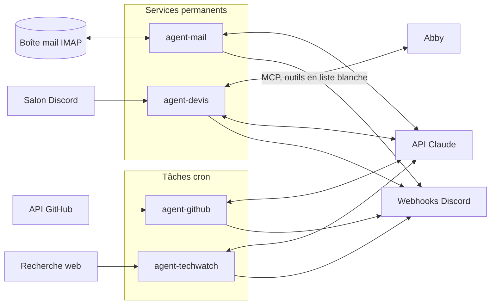

# agents-host

Quatre agents Python qui automatisent des tâches d'une activité de support IT (SafOps) : tri des mails, brouillons de devis, suivi des dépôts GitHub et veille technique. Chacun s'appuie sur l'API Claude, tourne dans son conteneur Docker et envoie ses résultats sur Discord.

## Les agents

| Agent | Déclenchement | Ce qu'il fait |
|---|---|---|
| `agent-mail` | Service permanent (IMAP IDLE) | Lit chaque nouveau mail, le résume, évalue l'urgence, le range dans un dossier IMAP (Urgent, Admin, Clients, Factures, Fournisseurs, Pub) et notifie sur Discord. Modèle : Haiku. |
| `agent-devis` | Service permanent (lecture d'un salon Discord toutes les 10 s) | Prend une demande de devis écrite dans un salon, cherche ou crée le client dans Abby (facturation) et crée un devis en brouillon. Modèle : Sonnet, avec des outils exposés via MCP. |
| `agent-github` | Cron quotidien | Analyse mes dépôts GitHub (hors forks) : activité, issues, PR, README. Envoie un rapport avec une suggestion concrète par dépôt à traiter. Modèle : Haiku. |
| `agent-techwatch` | Cron hebdomadaire (lundi) | Cherche sur le web les actualités DevOps, cloud et sécurité de la semaine (versions majeures, CVE, tendances) et envoie 5 à 6 points sourcés. Modèle : Sonnet avec l'outil `web_search` (5 recherches max). |

## Architecture



- Chaque agent est un dossier autonome avec son `Dockerfile`, son `config.py` et son `requirements.txt`.
- `classifier.py` contient l'appel à Claude et le prompt système, `notifier.py` l'envoi Discord, `main.py` l'orchestration.
- Les agents cron n'ont pas de mémoire : ils tournent, envoient leur rapport et s'arrêtent.

## Choix de conception

- **Entrées traitées comme non fiables.** Le contenu des mails, des demandes de devis, des issues GitHub et des pages web est signalé à Claude comme donnée, jamais comme instruction (protection contre l'injection de prompt).
- **Droits minimaux pour `agent-devis`.** Seuls 6 outils Abby sont autorisés (liste blanche dans `mcp_client.py`), tout autre appel est refusé. Le devis reste en brouillon : l'agent ne le finalise, ne l'envoie et ne le signe jamais. Seul le propriétaire du salon est écouté.
- **Pas de secret dans le code.** Tout passe par des variables d'environnement, vérifiées au démarrage : une variable manquante arrête l'agent avec un message clair. Le fichier `.env` n'est pas versionné.
- **Dégradation propre.** Si l'API Claude ou Discord échoue, l'erreur est loguée et l'agent ne plante pas (le mail est classé par défaut dans `Admin`, par exemple).
- **Coût maîtrisé.** Haiku pour les tâches répétitives, Sonnet seulement quand l'agent utilise des outils. Le nombre de recherches web et de tours d'outils est plafonné.
- **Compatibilité IMAP.** Le déplacement des mails utilise `MOVE` si le serveur le gère, sinon `COPY` puis suppression.

## Stack

Python 3.12, Docker Compose, SDK Anthropic, MCP, `imapclient`, `requests`, `python-dotenv`, cron.

## Installation

Prérequis : Docker avec le plugin Compose, une clé API Anthropic, un webhook Discord par agent.

1. Créer un fichier `.env` à la racine (non versionné), avec les variables des agents que tu lances :

| Agent | Variables |
|---|---|
| tous | `ANTHROPIC_API_KEY` |
| `agent-mail` | `IMAP_SERVER`, `IMAP_USER`, `IMAP_PASSWORD`, `DISCORD_MAIL_WEBHOOK_URL` |
| `agent-devis` | `ABBY_MCP_URL`, `ABBY_MCP_TOKEN`, `DISCORD_DEVIS_WEBHOOK_URL`, `DISCORD_BOT_TOKEN`, `DISCORD_DEVIS_CHANNEL_ID`, `DISCORD_OWNER_ID` |
| `agent-github` | `GITHUB_TOKEN`, `DISCORD_GITHUB_WEBHOOK_URL` |
| `agent-techwatch` | `DISCORD_TECHWATCH_WEBHOOK_URL` |

2. Pour `agent-devis`, ajouter `agent-devis/knowledge/entreprise.md` et `agent-devis/knowledge/tarifs.md` (grille tarifaire, TVA, conditions). Ce dossier est ignoré par git.

## Utilisation

Services permanents :

```
docker compose up -d --build agent-mail agent-devis
docker compose logs -f agent-mail
```

Tâches ponctuelles (lancement manuel) :

```
docker compose run --rm agent-github
docker compose run --rm agent-techwatch
```

Planification : chaque agent cron fournit sa ligne dans `agent-*/crontab`. Il faut les réunir dans une seule crontab (installer un fichier remplace la crontab existante).

## Structure

```
agents-host/
├── docker-compose.yml
├── agent-mail/        # config, mailbox (parsing), classifier, organizer (IMAP), notifier, main
├── agent-devis/       # config, discord_inbox, mcp_client, classifier, notifier, main, knowledge/
├── agent-github/      # config, github_client, classifier, notifier, main, crontab
└── agent-techwatch/   # config, classifier, notifier, main, crontab
