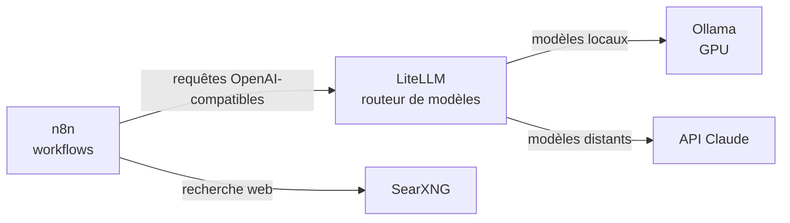

# agents-host

Guide pas à pas pour monter chez soi une plateforme d'automatisation basée sur l'IA :

- **n8n** pour construire et lancer les workflows ;
- **Ollama** pour faire tourner un modèle de langage en local (GPU NVIDIA) ;
- **LiteLLM** : un point d'entrée unique qui route chaque workflow vers le bon modèle (local ou Claude) ;
- **SearXNG** : un moteur de recherche web que les workflows peuvent interroger.

Le dossier `workflows/` contient les workflows n8n prêts à importer. Chacun est indépendant : tu choisis ceux que tu veux.

## Architecture



| Service | Rôle | Port par défaut |
|---|---|---|
| `n8n` | Éditeur et moteur de workflows | 5678 |
| `ollama` | Exécute les modèles locaux | 7869 (11434 dans le réseau Docker) |
| `ollama-pull` | Télécharge le modèle au premier lancement, puis s'arrête | aucun |
| `litellm` | Route chaque nom de modèle vers Ollama ou Claude | 4000 |
| `searxng` | Recherche web, sans compte ni clé | 8888 |

Tous les services partagent un réseau Docker `agent` : entre eux, ils se joignent par leur nom (`http://litellm:4000`, `http://ollama:11434`, `http://searxng:8080`).

## Prérequis

- Linux avec Docker et le plugin Compose (`docker compose version`).
- Une carte NVIDIA et son pilote (`nvidia-smi` doit répondre) pour Ollama sur GPU. Sans GPU, voir « Lancer sans GPU ».
- `nvidia-container-toolkit` pour donner le GPU aux conteneurs.
- Une clé API Anthropic, seulement pour les workflows qui utilisent Claude (`devis`, `prospects`).

## Installation

### 1. Récupérer le projet

```
git clone https://github.com/Juyuroto/agents-host
cd agents-host
```

### 2. Préparer le GPU (NVIDIA)

Vérifie que Docker peut voir le GPU via CDI :

```
nvidia-ctk cdi list
```

Si la commande répond `Found 0 CDI devices`, génère la spécification puis redémarre Docker :

```
sudo mkdir -p /etc/cdi
sudo nvidia-ctk cdi generate --output=/etc/cdi/nvidia.yaml
sudo systemctl restart docker
```

La liste doit maintenant contenir `nvidia.com/gpu=all`. À refaire après une mise à jour du pilote NVIDIA.

### 3. Créer le fichier `.env`

À la racine du projet, crée `.env` (jamais commité) :

```bash
mv .env.example .env
```

| Variable | Rôle |
|---|---|
| `N8N_HOST` | Nom sous lequel tu ouvres n8n (`localhost` en local) |
| `WEBHOOK_URL` | URL de base que n8n donne à ses webhooks |
| `ANTHROPIC_API_KEY` | Clé Claude, utilisée par LiteLLM pour des agens qui ont besoin de puissance |
| `LITELLM_MASTER_KEY` | Mot de passe d'accès à LiteLLM, à inventer. Génère-le : `echo "sk-$(openssl rand -hex 16)"` |

### 4. Lancer la pile

```bash
docker compose up -d
```

Au premier lancement, `ollama-pull` télécharge le modèle `qwen3:8b` : compte quelques minutes selon ta connexion. Suis-le avec :

```bash
docker compose logs -f ollama-pull
```

### 5. Vérifier chaque service

```bash
docker compose ps
```

Ollama (le modèle doit apparaître dans la liste) :

```bash
curl http://localhost:7869/api/tags
```

LiteLLM (remplace la clé par ta `LITELLM_MASTER_KEY`) :

```bash
curl http://localhost:4000/v1/chat/completions \
  -H "Authorization: Bearer sk-xxxxxxxx" \
  -H "Content-Type: application/json" \
  -d '{"model": "mail", "messages": [{"role": "user", "content": "Dis bonjour"}]}'
```

SearXNG :

```bash
curl "http://localhost:8888/search?q=docker&format=json"
```

Si SearXNG répond `403`, le format JSON est désactivé : voir « SearXNG » plus bas.

### 6. Ouvrir n8n

Va sur `http://localhost:5678` (pas sur une IP : voir « Dépannage ») et crée le compte propriétaire.

## Configuration

### LiteLLM : choisir le modèle de chaque workflow

Le fichier `litellm_config.yaml` associe un **nom de modèle** (celui que tes workflows envoient) à un modèle réel :

| Nom | Modèle réel | Où il tourne |
|---|---|---|
| `mail` | `ollama/qwen3:8b` | local |
| `discord` | `ollama/qwen3:8b` | local |
| `techwatch` | `ollama/qwen3:8b` | local |
| `devis` | `anthropic/claude-sonnet-4-5` | API Claude |
| `prospects` | `anthropic/claude-sonnet-4-5` | API Claude |

Pour changer le modèle d'un workflow, modifie la ligne `model:` de son entrée, puis :

```bash
docker compose restart litellm
```

Pour ajouter un modèle local : change le nom dans `ollama-pull` (`docker-compose.yml`) et dans `litellm_config.yaml`.

### Appeler LiteLLM depuis n8n

Dans un nœud **HTTP Request** :

- Méthode : `POST`
- URL : `http://litellm:4000/v1/chat/completions`
- En-tête : `Authorization` = `Bearer <LITELLM_MASTER_KEY>`
- Corps JSON :

```json
{
  "model": "mail",
  "messages": [
    {"role": "system", "content": "Tu classes les mails par catégorie."},
    {"role": "user", "content": "{{ $json.textPlain }}"}
  ]
}
```

Utilise le nom de l'URL Docker (`litellm`), pas `localhost` : n8n tourne dans son propre conteneur.

### Chercher sur le web avec SearXNG depuis n8n

Nœud **HTTP Request**, méthode `GET`, URL `http://searxng:8080/search`, paramètres de requête `q` (ta recherche) et `format` = `json`.

Au premier lancement, SearXNG génère `searxng/settings.yml`. Pour que `format=json` fonctionne, ajoute `json` à la liste des formats :

```yaml
search:
  formats:
    - html
    - json
```

puis `docker compose restart searxng`. TODO: vérifier la structure exacte de `settings.yml` avec la version de l'image utilisée.

### Lancer sans GPU

Dans `docker-compose.yml`, supprime le bloc `deploy:` du service `ollama`. Le modèle tournera sur le processeur, nettement plus lentement.

## Les workflows

Le dossier `workflows/` contient un workflow n8n par sous-dossier. TODO: lister ici chaque workflow (nom, ce qu'il fait, modèle LiteLLM utilisé, services externes requis) quand le dossier sera rempli.

Importer un workflow :

1. Dans n8n, crée un nouveau workflow.
2. Menu `...` en haut à droite, puis **Import from file**, et choisis le fichier `.json`.
3. Ouvre chaque nœud marqué d'une alerte rouge et recrée ses **identifiants** (IMAP, Discord, etc.) : l'export d'un workflow n'inclut pas les secrets.
4. Dans les nœuds HTTP Request vers LiteLLM, renseigne ton en-tête `Authorization`.
5. Clique sur **Execute workflow** pour tester, puis active-le.

## Sécurité

- Les ports sont publiés sur toutes les interfaces de la machine. Sur un réseau partagé, limite-les à la machine locale en les préfixant dans `docker-compose.yml` : `127.0.0.1:5678:5678`, `127.0.0.1:4000:4000`, etc.
- Ne commite jamais `.env`. Ne mets aucune clé dans un workflow exporté.
- `N8N_SECURE_COOKIE=false` est acceptable en local sur HTTP. Pour un accès depuis un autre poste, place n8n derrière un reverse proxy HTTPS et retire cette variable.

## Dépannage

| Symptôme | Cause et solution |
|---|---|
| `CDI device injection failed: unresolvable CDI devices nvidia.com/gpu=all` | Spécification CDI absente : étape 2. |
| `Bind for 127.0.0.1:5678 failed: port is already allocated` | Un autre conteneur (un autre n8n) utilise ce port. Arrête-le, ou change le port hôte. |
| Ollama redémarre en boucle avec `permission denied` sur `/root/.ollama` | Sur une distribution avec SELinux (Fedora...), le volume doit se terminer par `:Z`. C'est déjà le cas dans ce `docker-compose.yml`. |
| LiteLLM redémarre avec `Config file not found: /app/config.yaml` | Même cause : SELinux bloque le montage de `litellm_config.yaml`. Ajoute `:Z` à ce volume. TODO: l'ajout de `:Z` à ce volume n'est pas encore dans `docker-compose.yml`. |
| n8n : « configured to use a secure cookie » | Tu ouvres n8n par une IP ou un nom en HTTP. Utilise `http://localhost:5678`, ou mets n8n derrière HTTPS. |
| n8n : `ECONNREFUSED` vers `litellm:4000` | LiteLLM est arrêté ou en erreur : `docker compose logs litellm`. |

## Structure

```
agents-host/
├── docker-compose.yml     # n8n, ollama, ollama-pull, litellm, searxng
├── litellm_config.yaml    # correspondance nom de modèle -> modèle réel
├── workflows/             # un workflow n8n par sous-dossier
├── ollama/                # modèles téléchargés (ignoré par git)
├── searxng/               # configuration générée (ignorée par git)
└── .env                   # tes secrets (ignoré par git)
```
